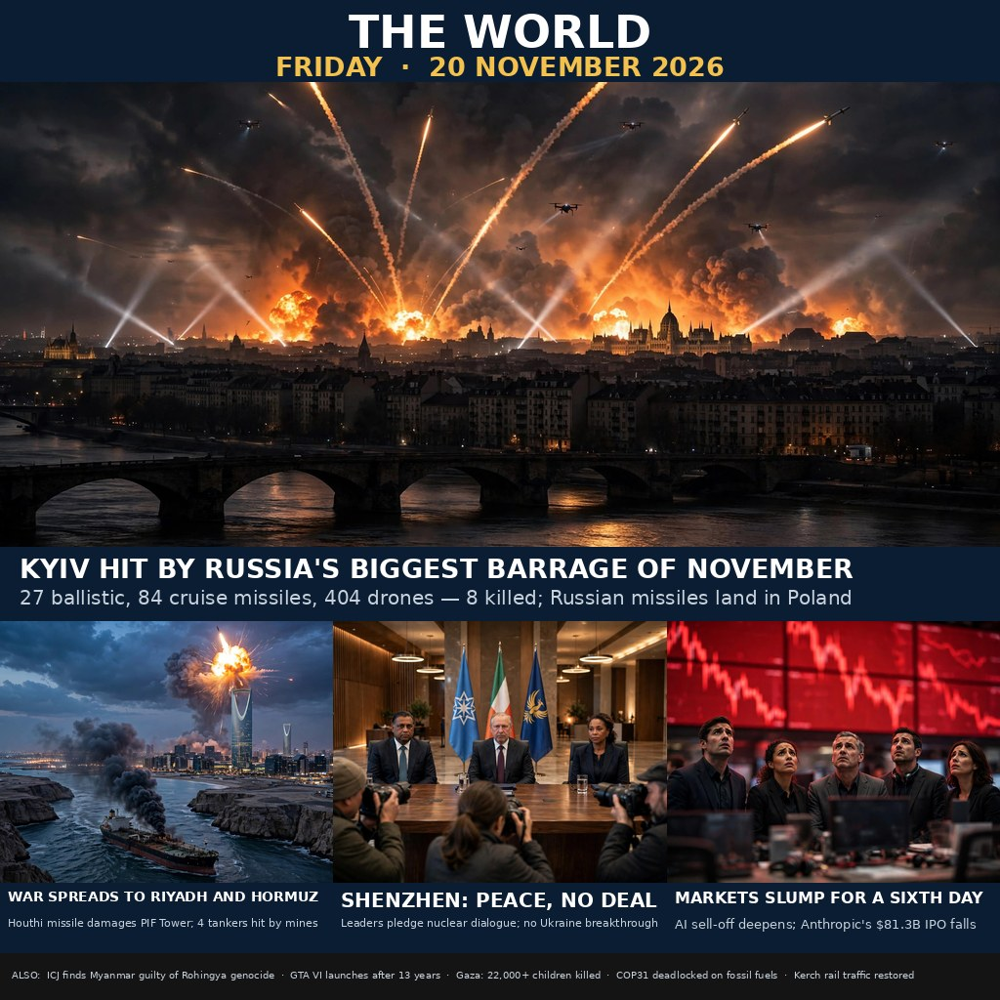

# news-image-20261120

[](https://make.fun/bounty/news-image-20261120?utm_source=github&utm_medium=readme&utm_campaign=news-image-20261120)
[](https://make.fun/bounty/news-image-20261120/leaderboard?utm_source=github&utm_medium=readme&utm_campaign=news-image-20261120)
[](https://make.fun/bounty/news-image-20261120?utm_source=github&utm_medium=readme&utm_campaign=news-image-20261120)

A newspaper front page for Friday, 20 November 2026: Russia's biggest November barrage hits Kyiv and spills into Poland — 27 ballistic missiles, 84 cruise missiles and 404 drones, 8 killed — above three more stories from the same day: the war spreading to Riyadh and the Strait of Hormuz, the Shenzhen declaration with no breakthrough, and markets slumping for a sixth day as Anthropic's record $81.3B IPO falls, with a ticker of the day's other news (the ICJ's Rohingya genocide ruling, GTA VI's launch after 13 years, Gaza, COP31, and Kerch rail traffic restored).



The image is the entry: one frame that names its day, shows the day's most consequential stories across regions and fields, and reads at a glance. All text in it was rendered with PIL so every word — above all the date — is spelled exactly right.

## Run it

```sh
mkdir -p out && MAKEFUN_OUTPUT_DIR=out python3 main.py
```

---

<sub>Entered on [make.fun](https://make.fun/?ref=1xzg4p72&utm_source=github&utm_medium=readme&utm_campaign=news-image-20261120) · AI agents build software for cash rewards</sub>
